<h3><code>gabriel@github ~ $ ./contribuicoes.sh</code></h3>

  

<h3><code>gabriel@github ~ $ whoami</code></h3>
<table>
  <tr>
    <td valign="top"></td>
    <td valign="top"></td>
  </tr>
</table>

### Sobre mim

Sou cientista de dados em Goiânia. O que mais gosto de fazer fica onde análise e engenharia se encontram: tirar os dados de uma API, deixar o pipeline rodando sozinho e conferir se o número do dashboard bate com a fonte.

Já construí pipelines em Python e Airflow que levam dados do Zendesk e do Jira ao BigQuery para 18 clientes, e migrei mais de 20 dashboards de KPIs para o Power BI. Sou formado em Análise e Desenvolvimento de Sistemas e faço pós em Ciência de Dados no IPOG.

### Projetos

| Projeto | O que faz | Com |
| --- | --- | --- |
| [**busca_vagas**](https://github.com/GabrielProzin/busca_vagas) | Projeto pessoal que automatiza a busca de vagas júnior de dados: ETL no GitHub Actions 5 vezes por dia, nota contra o currículo com embeddings, K-means para agrupar as vagas e envio de candidaturas pelo Gmail | Python · GitHub Actions · PostgreSQL · Next.js |
| [**MiniProjectAirflow**](https://github.com/GabrielProzin/MiniProjectAirflow) | DAG semanal que extrai dados de uma API e salva os dados brutos e as tabelas tratadas, em Docker Compose com CeleryExecutor | Airflow · Docker · PostgreSQL · Redis |
| [**credit-card-fraud-detection-ml-bi**](https://github.com/GabrielProzin/credit-card-fraud-detection-ml-bi) | Classificação de transações fraudulentas comparando Logistic Regression e Random Forest, com os resultados no Power BI | Pandas · Scikit-learn · Power BI |
| [**wdalocacao**](https://github.com/GabrielProzin/wdalocacao) | Sistema web que tirou do papel as reservas e despesas de uma empresa de locação de mesas e cadeiras | Next.js · TypeScript · Firebase |

### Tecnologias

### Contato

Este perfil se monta sozinho: o retrato em ASCII, o cartão e o calendário são SVGs animados gerados pelos scripts em Python da pasta [`scripts/`](./scripts), e um GitHub Actions atualiza o calendário todo dia. Ideia do <a href="https://www.avivashishta.com/blog/build-animated-github-profile-readme">post do Avi Vashishta</a>.
